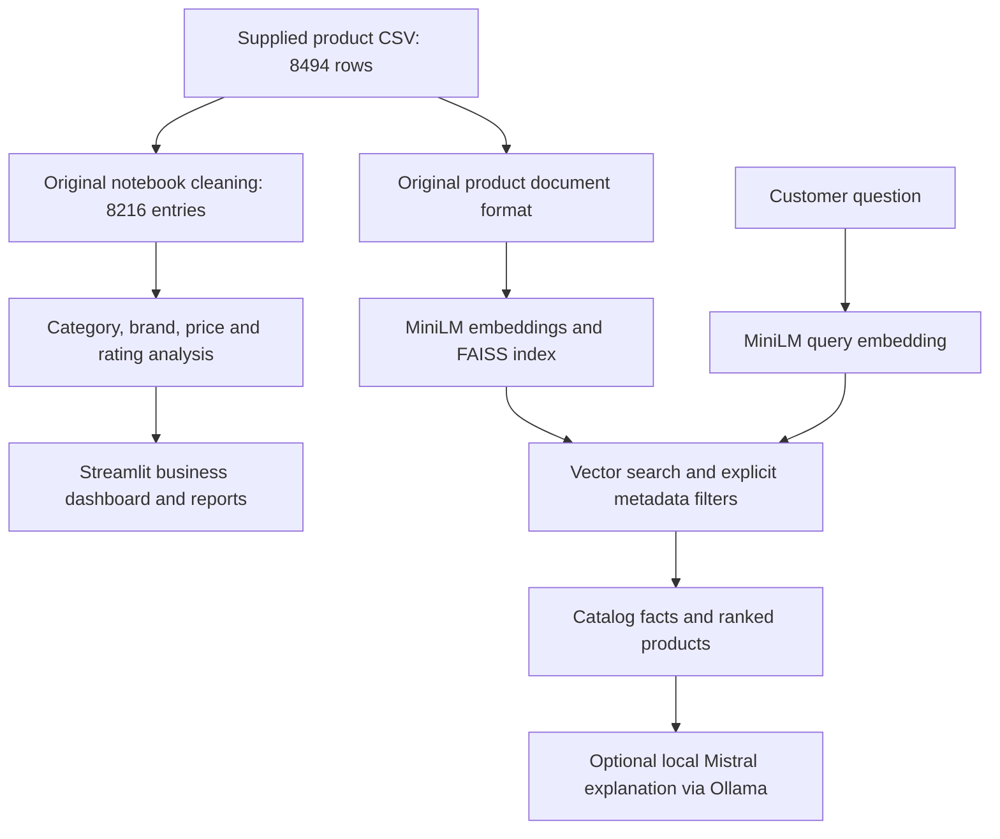

# Beauty Product Analytics & Search

A student project for two audiences: a **business analyst** comparing product categories, price positioning, brands and engagement, and a **customer** discovering products within explicit preferences.

The original analysis and retrieval pipeline are preserved. The added Streamlit interface connects those ideas without modifying `analysis.ipynb`, `rag.py`, or `Dataset/product_info.csv`.

## What is verified in this package

- The supplied CSV contains **8,494 products and 27 columns**.
- The notebook's cleaning rules retain **8,216 analysis entries**: select its 11 columns, remove duplicate rows, then drop rows missing price, rating or review count. This excludes 278 rows; it does not imply those products are invalid.
- The analysis subset covers **302 brands and 9 primary categories**. Its median listed price is **$35**.
- The provided FAISS file contains **8,494 normalized, finite vectors with 384 dimensions**. It is included unchanged and is about **12.44 MiB**.
- Dashboard and code checks are recorded under `reports/`.

**Validation limit:** the embedding model download was blocked by this cloud environment's Hugging Face network restriction. The supplied index's document/vector alignment and live semantic search have therefore **not been verified here**. Live Mistral generation and answer grounding accuracy are also **not measured**. The dashboard's business analysis works independently. The added search interface requires the verification or rebuild step below rather than silently trusting an unmatched index. No search accuracy, business impact or customer satisfaction figure is claimed.

## Architecture



The new utilities keep the original CSV → documents → embeddings → FAISS → filtered retrieval → Mistral flow. They add checksum checks, a reproducible index builder, and stricter filters. The new retrieval searches this small index in full before applying metadata eligibility, avoiding the original CLI's top-200 candidate limitation. Prices and ratings displayed in the app come from the CSV; generated text still needs review.

## Setup

Tested with Python 3.12 on Linux, CPU only. Use a virtual environment. From the extracted project directory:

```bash
python3 -m venv .venv
source .venv/bin/activate
python -m pip install --upgrade pip
# CPU-only PyTorch, avoiding unnecessary CUDA packages:
python -m pip install torch==2.6.0 --index-url https://download.pytorch.org/whl/cpu
python -m pip install -r requirements-dev.txt
python -m pip check
```

On Windows activate with `.venv\Scripts\activate`; use the appropriate official PyTorch wheel for your platform. The exact installed Linux package versions are captured in `docs/tested-environment.txt` for reference; the requirements files are the primary installation instructions.

### Run business analysis immediately

```bash
streamlit run app.py
```

Use the Business analysis tab to filter categories, compare assortment and median prices, explore price versus rating, and compare brands with minimum product/review thresholds. Download the category summary from the dashboard. Open `reports/category_comparison.html` in a browser for the included standalone interactive chart.

### Enable semantic product discovery

The first run needs Internet access to download the public `sentence-transformers/all-MiniLM-L6-v2` model from Hugging Face, including its model-file redirect hosts. Models are cached locally; model weights are not bundled in this ZIP.

First try to validate the supplied index against newly encoded documents:

```bash
python build_index.py --verify-existing
```

This checks 12 evenly spaced document/vector pairs, not every pair. If it reports a mismatch, rebuild from the CSV using the same document format and normalized embeddings:

```bash
python build_index.py
```

Rebuilding replaces `sephora_products.index`; make a copy first if you want to retain the supplied file. A successful command writes `sephora_products.manifest.json`, binding the dataset, document format, model name and index hashes. The app refuses missing or changed manifests. After verification/rebuilding, open Product discovery, enter a question, and select brand, category, price and rating filters explicitly. Constraints written only in a natural-language question are not automatically converted into filters. Similarity scores are rankings, not probabilities of suitability.

### Optional Mistral explanations

Install Ollama from its official distribution, then in separate terminals as needed:

```bash
ollama serve
ollama pull mistral
```

Enable the Mistral checkbox in the app. The default API is `http://127.0.0.1:11434`; `OLLAMA_URL` can override it. Mistral needs additional disk space and RAM, and can be slow on CPU. Generation is optional: vector retrieval does not require Ollama. The original CLI remains available from the project root:

```bash
python rag.py
```

The preserved CLI loads its model/index directly and retains its original behavior. Prefer the added app for checksum validation and strict metadata filters.

## Reproduce the checks and outputs

```bash
python generate_reports.py             # Recompute category/brand CSVs and HTML chart
python validate_project.py             # Recompute counts and resume count checks
python inspect_index.py                # Structural checks only; no embedding model needed
python -m pytest -q --junitxml=reports/tests.xml
# After model download and index verification/rebuild:
python validate_project.py --check-index
python run_search_checks.py
# Optional actual local generation:
python run_search_checks.py --with-mistral
```

`run_search_checks.py` writes actual retrieved IDs, scores and elapsed times for three filtered searches. It exits nonzero on failure and records the failure. It is a functional smoke test, not a labeled relevance benchmark. Tests that simulate HTTP responses or vectors are explicitly fixtures; they are not live model results. `reports/search_checks.json` in this package records the current unmet index-verification prerequisite.

## Results and interpretation

All published numeric summaries here can be recomputed from the supplied CSV. See `reports/business_summary.json`, `category_summary.csv`, `brand_summary.csv`, and `index_structure.json`. The price/rating Pearson correlation is approximately **0.057** in the cleaned subset: this is a weak descriptive association, not evidence of a causal price effect.

- Category counts describe catalog assortment, not market share.
- Brand ratings are unweighted means of product ratings, not customer-level satisfaction estimates. Product/review thresholds reduce sparse comparisons but do not establish statistical superiority.
- Loves and review counts are engagement proxies, not sales, profit, conversion or demand estimates.
- Analysis uses 8,216 cleaned entries; retrieval uses all 8,494 original products and represents missing values as unavailable. A rating filter excludes missing ratings.
- This is a static snapshot. Prices, assortment and availability may be outdated. There are no transactions, customer histories, sales dates, or demographic records, so there is no revenue analysis, customer segmentation or personalized recommender evaluation.
- Product text is insufficient to guarantee medical suitability or product effectiveness. A model instruction to use the context does not prove factual grounding.

## Reliability and limitations

The added Ollama client uses a 5-second connection timeout and 180-second read timeout. It rejects HTTP errors, incomplete responses, invalid JSON, unsupported product IDs and duplicate IDs. The UI shows failures; it does not substitute an invented answer. These timeouts are request settings, not measured availability guarantees. No automatic retries are made.

Checksums detect changes relative to a local manifest, not malicious tampering with both artifacts. The supplied index has passed structural checks only; run document alignment verification or rebuild before using it. Only trusted local FAISS artifacts should be loaded. Model names and Ollama tags can change upstream: record exact model revisions/digests for any future measured experiment. No precision/recall or hallucination rate is reported without a labeled evaluation.

## Files and preserved work

- `analysis.ipynb`, `rag.py`, `Dataset/product_info.csv`: original files, byte-for-byte preserved. Notebook outputs are the original author's saved outputs, not a newly executed notebook run.
- `app.py`: filled the previously empty dashboard file.
- `product_pipeline.py`: shared additive analysis, indexing, filtering and generation utilities.
- `build_index.py`, `inspect_index.py`, `validate_project.py`, `generate_reports.py`, `run_search_checks.py`: reproducible commands.
- `tests/`: preservation, data, filtering, document compatibility, retrieval, API and dashboard checks.
- `docs/`: change scope, resume claim mapping and tested environment.
- `reports/`: small, actual summaries, test outcomes and explicitly incomplete search checks.

## Resume claims

The exact two supplied resume bullets are mapped to evidence and limitations in [docs/RESUME_CLAIMS.md](docs/RESUME_CLAIMS.md). The dataset counts are independently confirmed. Embeddings, FAISS, filters and Mistral integration exist in the original and added code, but live end-to-end retrieval/generation still requires the external model prerequisite above. Do not describe that runtime path as verified until you run it successfully.

## GitHub upload and dataset provenance

Extract this ZIP and upload the folder contents, including `Dataset/` and the index. The index is below GitHub's 25 MiB browser limit for a single file and 100 MiB normal Git file limit; no Git LFS setup is needed for this file. `.gitignore` now allows the index and excludes environments/caches. Alternatively, use normal `git add`, `git commit` and `git push` in your own repository. Do not upload the virtual environment or downloaded Ollama/model caches.

The CSV is the user-supplied Sephora product snapshot. Its original source URL, collection date and redistribution license were not supplied; this package does not invent them or assert permission to redistribute third-party data. Add the actual source and terms before making the dataset public. No license for third-party data is granted by this repository.
